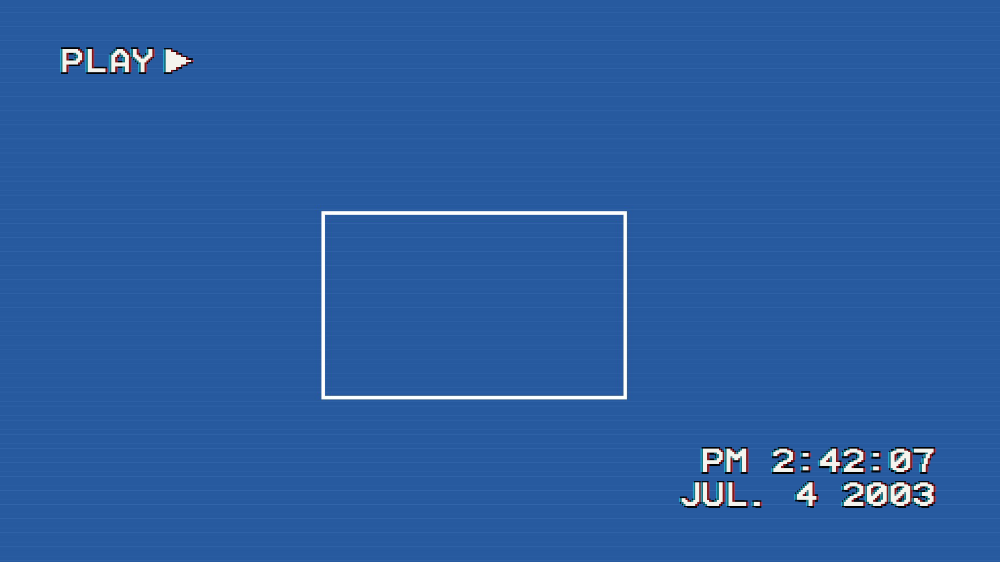

# VHS Slideshow Stamp

A Kodi service add-on that makes a slideshow look like an old home video played on a VCR.

- **PLAY, PAUSE, FF and REW** show top left, as a VCR's on-screen display does. PLAY clears after a few seconds.
- **The time and date** each photo was taken (from its EXIF data) or each home video was recorded (from its MP4/MOV
  header) is stamped bottom right, as a camcorder stamps it on the tape. While a video plays, the time ticks along.

It lays its own labels over Kodi's slideshow window, so it works with any skin.

## Requirements

Kodi 22 or later, and [resource.font.supervcrmono](https://github.com/xbmc/repo-resources), which provides the
Super-VCR Mono font by ASmolBoy (CC BY 4.0).

## Licence

GPL-2.0-or-later, see LICENSE.txt.
